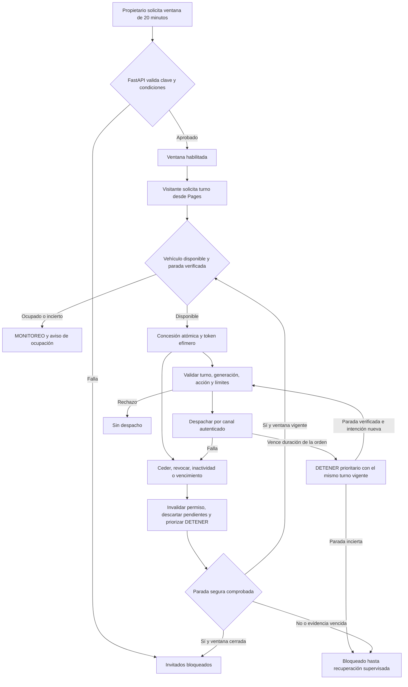

# Control público temporal del vehículo IoT

## Estado de la etapa 5.2

La etapa 5.1 protegió las escrituras existentes con `X-API-Key`. La etapa 5.2 implementa las ventanas, los turnos, la autorización y el despacho exclusivamente simulado. La configuración predeterminada mantiene cerrado el acceso de invitados. El firmware, el canal autenticado del dispositivo y la interfaz de invitado pertenecen a una fase posterior.

| Capacidad | Estado de la etapa 5.2 |
| --- | --- |
| Rutas HTTP de ventana, auditoría, turno, órdenes y DETENER | Implementadas para simulación local. |
| Almacén de coordinación, exclusividad, caducidad y recuperación | Implementados sobre SQLite independiente. |
| Despacho físico, confirmación física y cambio del firmware | Pendientes de integración y validación física. |
| Ocupación por WSS, catálogo RDS para invitados e interfaz en Pages | Propuestos. La consulta HTTP de ocupación ya está disponible. |

En la instancia simulada, los POST existentes de movimiento y de inicio y cancelación de DEMO rechazan el despacho con 503 después de validar la clave. El propietario revoca o detiene la simulación mediante las rutas nuevas. El comportamiento de los endpoints existentes con los flags apagados conserva el contrato de 5.1. Esta separación permite validar los turnos sin alcanzar RDS ni el emisor WSS desde el motor simulado. La futura unificación del despacho administrativo y de invitados requiere el coordinador físico y su propia revisión.

La demostración propuesta dura inicialmente **20 minutos** por vehículo y requiere habilitación explícita del propietario. El profesor usaría [la URL actual de GitHub Pages](https://yori7v7.github.io/control-iot-u4/) desde un navegador normal o de incógnito. Un visitante puede solicitar un turno sin usuario, contraseña, clave administrativa ni datos personales. Un modo público permite que personas desconocidas intenten operar el vehículo. Debe limitarse a una demostración supervisada en un recinto controlado, con parada local independiente y evidencia de que el relevo es seguro.

Este diseño concreta la [propuesta de CONTROL público del frontend](https://github.com/yori7v7/control-iot-u4/blob/8f7c56a9af57bf84c635da02fa7a300aef332472/assets/docs/control-publico.md). La URL de Pages se mantiene. La sesión se autoriza con un token opaco en memoria de la pestaña, por lo que el flujo funciona entre Pages y la API sin depender de cookies de terceros.

## Ejecutar la simulación local

Usa un entorno de desarrollo aislado, con una clave ficticia y sin configuración de RDS. Define los dos flags juntos y asigna una ruta absoluta fuera del repositorio. El directorio padre debe existir y ser privado. En Windows se verifica la ACL del propietario, SYSTEM y Administradores. En POSIX se exige propiedad del usuario del proceso y permisos privados. Usa disco local y un único proceso Uvicorn con el mismo archivo SQLite por instancia.

```powershell
$env:APP_ENV = 'development'
$env:API_KEY = 'clave-ficticia-local'
$env:CONTROL_PUBLICO_ENABLED = 'true'
$env:CONTROL_PUBLICO_SIMULATION = 'true'
$env:CONTROL_PUBLICO_SQLITE_PATH = 'C:\ruta-privada-fuera-del-repositorio\control.sqlite3'
.\.venv\Scripts\python.exe -m uvicorn app.main:app --host 127.0.0.1 --workers 1 --no-proxy-headers
```

En el otro terminal, la ventana y el turno se pueden comprobar mediante el ASGI local. La cabecera `Origin` reproduce el origen permitido para el flujo de invitado. La asignación de la concesión evita imprimir su token.

```powershell
$base = 'http://127.0.0.1:8000'
$admin = "$base/admin/vehiculos/1/control-publico"
$guest = "$base/publico/vehiculos/1"
$ownerHeaders = @{ 'X-API-Key' = 'clave-ficticia-local' }
$visitorHeaders = @{ Origin = 'https://yori7v7.github.io' }
$window = @{ id_solicitud = [guid]::NewGuid().ToString(); duracion_seg = 1200; supervision_confirmada = $true }
Invoke-RestMethod "$admin/ventana" -Method Put -Headers $ownerHeaders -ContentType 'application/json' -Body ($window | ConvertTo-Json)
$turn = Invoke-RestMethod "$guest/sesion" -Method Post -Headers $visitorHeaders -ContentType 'application/json' -Body '{}'
$turnHeaders = @{ Origin = $visitorHeaders.Origin; Authorization = "Bearer $($turn.token)" }
Invoke-RestMethod "$guest/sesion" -Method Get -Headers $turnHeaders
Invoke-RestMethod "$guest/sesion" -Method Delete -Headers $turnHeaders
Remove-Variable turn, turnHeaders
Invoke-RestMethod "$admin/ventana" -Method Delete -Headers $ownerHeaders
```

Con ambos flags apagados, FastAPI informa el estado cerrado y omite la inicialización del almacén y el simulador. Un flag sin el otro y la combinación en producción se rechazan al validar la configuración. Si el archivo, su bloqueo o la recuperación fallan, la instancia simulada conserva los endpoints académicos de lectura y rechaza el control simulado con 503. El límite de cuerpo de las rutas nuevas es 2048 bytes y las respuestas se marcan `Cache-Control: no-store`. La simulación exige cliente loopback. Para otro arranque, vuelve a apagar los flags o detén el proceso local.

### Implementación del piloto

| Componente | Responsabilidad |
| --- | --- |
| `http.py` y `models.py` | Contratos FastAPI, autenticación administrativa y de invitado, CORS acotado, validación y proyecciones. |
| `domain.py` | Lista blanca, tokens opacos y errores seguros. |
| `service.py` y `coordinator.py` | Ventanas, turnos, reloj, secuencias, idempotencia, caducidad, barreras y despacho serial. |
| `repository.py`, `schema.py`, `ownership.py` y `local_files.py` | SQLite independiente, migración inicial, archivos privados y propiedad exclusiva del coordinador. |
| `simulator.py` y `runtime.py` | Salidas virtuales, seguimiento de paradas, propiedad del proceso y barrido de vencimientos. |

La migración inicial crea `control_vehicle`, `control_turn`, `control_operation`, `control_window_request`, `control_stop_request` y `control_audit`. El estado por vehículo contiene la ventana, la revisión, la generación, la época y el interbloqueo. Un índice parcial único limita a un turno activo por vehículo. Las solicitudes de ventana, movimiento y parada tienen claves de idempotencia. SQLite usa journal de rollback `DELETE`, transacciones `BEGIN IMMEDIATE`, claves externas y `synchronous=FULL`. El archivo de bloqueo del sistema operativo dura toda la instancia. Ni el índice ni el bloqueo coordinan instancias en distintos hosts.

Las órdenes aceptadas se guardan antes del despacho. El barrido resuelve paradas y descartes antes de evaluar movimientos. La orden conserva su plazo monotónico de admisión. El simulador desactiva la salida virtual al alcanzar ese plazo, aunque falle la confirmación de parada. Una parada pendiente o incierta mantiene el interbloqueo. Una confirmación `verificada` en una respuesta con `simulado: true` describe únicamente el modelo virtual. Al reiniciar se revocan los turnos, se cierran las ventanas y se descartan órdenes pendientes; una salida previa no se reenvía.

## Componentes y flujo

- **FastAPI** valida credenciales y datos. La dependencia administrativa existente autoriza la ventana, la revocación y los endpoints protegidos. Una dependencia separada autoriza los tokens efímeros solo para el turno y el vehículo asignados.
- **Coordinador por vehículo** decide quién puede actuar, controla la duración y el orden de los movimientos, da prioridad a DETENER y mantiene el vehículo bloqueado mientras la parada esté pendiente o sea incierta. La futura integración física debe incorporar también el control manual y las DEMO del propietario antes de ejecutar o publicar.
- **Almacén SQLite local** conserva la ventana, el turno, las generaciones, la deduplicación y la auditoría. El simulador se mantiene separado de las seis tablas y los procedimientos académicos. La futura integración deberá resolver el catálogo activo mediante los servicios existentes.
- **Canal autenticado de dispositivo** sería el único canal de actuación mientras el modo temporal esté habilitado. Asocia cada orden y su vencimiento con una sesión del ESP8266 y recibe acuses diferenciados. WSS público sigue siendo un canal de observación.

El diagrama incluye el canal de dispositivo previsto para una etapa posterior. El piloto actual usa el simulador en ese punto.



### Permisos

| Operación | Visitante | Invitado con turno vigente | Propietario con API key |
| --- | --- | --- | --- |
| GET académicos y WSS de observación | Sí | Sí | Sí |
| Consultar disponibilidad pública y pedir turno | Sí, durante la ventana | Sí, la exclusividad sigue vigente | Sí |
| Consultar o ceder turno propio | Requiere token | Sí, para su vehículo | Puede consultar ocupación y revocar por rutas administrativas |
| Mover con lista blanca y pedir DETENER | Requiere token | Sí, sujeto al estado y límites del turno | Sus rutas actuales pasan por el coordinador |
| Ejecutar o cancelar DEMO programada y usar auxiliares | No | No | Sí, solo con su autorización y el vehículo disponible para su control |
| Administrar ventana, revocar y consultar auditoría | No | No | Sí |
| CRUD de vehículos, comandos, DEMO o pasos | No | No | Sí, con `require_api_key` y las validaciones existentes |

La exclusividad se aplica a toda actuación. Una solicitud administrativa de movimiento o de iniciar DEMO durante un turno invitado devuelve conflicto. El propietario conserva la revocación y la parada prioritaria. Revocar, deshabilitar o ejecutar un DETENER administrativo invalida de inmediato el permiso invitado y activa el flujo de parada. El propietario puede comenzar su control después de que la parada esté confirmada. Una modificación de configuración que altere el vehículo, el catálogo permitido o DETENER exige cerrar primero la ventana y alcanzar estado seguro. El servidor mantiene la validación de pertenencia de cada recurso.

## Token de invitado y CORS

1. FastAPI crea un token aleatorio de 256 bits, opaco y codificado en base64url sin relleno. Lo entrega una sola vez en el cuerpo de la concesión HTTPS con `Cache-Control: no-store`. El almacén persiste un resumen SHA-256 del token aleatorio de alta entropía, el vehículo, el turno, la ventana y la generación. La validación rechaza tokens inválidos, vencidos, revocados o para otro vehículo. El token de invitado carece de permisos de API key y viceversa.
2. La pestaña guarda el token solo en memoria y lo envía explícitamente en `Authorization: Bearer …`, con `credentials: 'omit'`. Recargar, cerrar, ceder o perder el turno descarta esa copia. Un corte de red o una respuesta de concesión perdida no se interpreta como liberación. El backend aplica la expiración y verifica la parada antes de conceder otro turno. El token nunca va en URLs, WebSocket, cookies, almacenamiento web, recursos estáticos, registros ni herramientas de analítica. El token es una credencial de corta vida accesible al código de la página. Scripts comprometidos podrían leerlo, por lo que se exige revisar CSP, dependencias y usos del DOM. [Uso de Bearer por HTTPS](https://www.rfc-editor.org/rfc/rfc6750#section-2.1) · [Credenciales y CORS en Fetch](https://fetch.spec.whatwg.org/#cors-protocol-and-credentials)
3. En una fase posterior se configura CORS con el origen exacto `https://yori7v7.github.io`, `allow_credentials=False` y `Vary: Origin`. Autorizar por grupo únicamente los métodos y cabeceras utilizados. Para invitados se necesitan `GET`, `POST`, `DELETE`, sus preflights, `Content-Type` y `Authorization`. Para las nuevas rutas administrativas desde Pages se necesitan `GET`, `PUT`, `POST`, `DELETE`, `Content-Type` y `X-API-Key` según ruta. Conservar CORS de las rutas actuales y probar las respuestas de error desde Pages. Incluir `Retry-After` en las cabeceras expuestas solo si el frontend lo lee. El origen incluye todo el dominio de Pages de la cuenta. El navegador no puede aislar un prefijo de repositorio mediante CORS. Validar el origen de escrituras de invitados sirve como defensa de navegador. Los clientes no navegador pueden construir ese encabezado, así que cada operación requiere autorización real del servidor. [Configuración CORS de FastAPI](https://fastapi.tiangolo.com/tutorial/cors/)
4. Aceptar una sola credencial por solicitud y limitar el tamaño del cuerpo y las cabeceras. Limitar las solicitudes de turnos por vehículo y por red con un identificador de red seudónimo de retención corta y solo a partir de un proxy de confianza. Como valores para simulación, ensayar tres solicitudes por minuto por red y diez por minuto por vehículo, con espera anunciada para `429`. Reservar capacidad para DETENER y revocación al aplicar límites en la aplicación o el proxy. Registrar la decisión sin guardar tokens, claves, IP en claro ni cuerpos sensibles. El propietario puede cerrar la ventana ante intentos de acaparamiento o automatización.

## Turnos, concurrencia y persistencia

### Almacenamiento

| Alternativa | Garantías y alcance |
| --- | --- |
| Memoria del proceso | Adecuada para simulación. Pierde turnos al reiniciar y no coordina procesos. |
| SQLite separado en disco local de EC2 | Opción inicial. Transacciones durables y exclusividad entre conexiones del mismo host. Evita un servicio adicional y cambios al esquema académico. Un solo escritor a la vez, sin alta disponibilidad entre máquinas. |
| Esquema de coordinación separado en RDS existente | Posible si se requiere compartir estado entre hosts. Aumenta carga, permisos y dependencia de red. Requiere aprobación, aislamiento del esquema y otra revisión de costos. |

El piloto puede usar `sqlite3` de Python y disco ya asignado, con permisos restringidos al proceso, espacio monitorizado y respaldos probados. Se consumen espacio de disco y CPU de la instancia. Un volumen o respaldo adicional podría añadir costos. Proponer inicialmente journal de rollback y `synchronous=FULL`. Evaluar WAL si las lecturas justifican el cambio y comprobar `sqlite3.sqlite_version` contra una versión con la corrección de WAL, como 3.51.3 o una rama con el arreglo retroportado. El entorno de pruebas Windows de esta etapa usa SQLite 3.50.4 y no permite inferir la compilación instalada en EC2. WAL requiere que todas las conexiones estén en el mismo host con almacenamiento local y exige gestionar checkpoints. Ninguno de los dos modos coordina por sí solo el envío físico. [Transacciones SQLite](https://sqlite.org/lang_transaction.html) · [Requisitos y correcciones de WAL](https://sqlite.org/wal.html)

| Datos propuestos | Campos e invariantes |
| --- | --- |
| `ventana_control` | PK por vehículo, estado, inicio y fin UTC, revisión monotónica y generación de control. En arranque queda cerrada hasta habilitación nueva. |
| `turno_control` | ID de auditoría, vehículo, resumen de token único, generación, expiración absoluta y de inactividad, marca de revocación, estado y mayor secuencia recibida. Restricción única para un turno vigente por vehículo. |
| `operacion_control` | Identificador interno, turno, generación, época de parada, secuencia, ID idempotente, acción permitida, huella del cuerpo, vencimiento y resultado. Índice único de ID idempotente por turno. |
| `interbloqueo_control` | PK por vehículo, estado seguro, actor reservado, versión de barrera, última evidencia de dispositivo y arranque, parada pendiente y último resultado. Una parada pendiente sigue bloqueando aunque no exista turno vigente. |
| `auditoria_control` | Hora UTC, vehículo, ID de operación y turno seudónimo, rol, decisión, motivo y resultado de cada evidencia. Retención y acceso definidos antes del piloto. |

### Orden y recuperación

- El piloto mantiene **un proceso coordinador autorizado para despachar y un solo proceso Uvicorn**. Un bloqueo exclusivo del sistema operativo, como un mutex de Windows con ACL restringida mantenido durante la vida del coordinador, impide una segunda instancia de actuación en el mismo host. Si se requieren varios workers más adelante, todos los cambios de control se remiten por IPC local protegido al mismo coordinador. Los `asyncio.Lock` y los managers WSS/DEMO actuales son locales a un proceso. Antes de habilitar varios workers deben validarse IPC, distribución de eventos y ausencia de rutas que omitan el coordinador.
- Con `BEGIN IMMEDIATE` y espera acotada se reevalúan ventana, parada segura, generación y reserva y se crea un solo turno en la misma transacción. La restricción única protege frente a solicitudes simultáneas. Las transacciones son cortas y no retienen el bloqueo durante llamadas a MySQL ni I/O del dispositivo. `SQLITE_BUSY`, error de disco o coordinación incierta bloquean nuevos permisos y movimientos. Un intento de parada por el canal dedicado, si está disponible, y la parada local siguen siendo vías de contención.
- La admisión de una orden almacena el resultado idempotente y su orden lógico. Antes de despachar se revalidan permiso, disponibilidad, catálogo, generación, época y vencimiento. Se marca `en_transito` de forma durable antes de iniciar el envío. Por vehículo solo se admite un movimiento activo. Las intenciones adicionales no extienden un plazo físico ni se acumulan como movimientos contradictorios. Tras cada límite de duración, conservar el turno válido y exigir neutral seguro antes de una nueva intención. El actor procesa DETENER antes de nuevos movimientos. Una orden cuyo envío ya comenzó puede llegar antes de la parada, por lo que el dispositivo aplica su propio vencimiento y rechaza operaciones obsoletas tras recibir la barrera. La concesión siguiente espera confirmación de estado seguro.
- Ceder, revocar, vencer el turno, alcanzar la inactividad o cerrar la ventana invalida el token en una transacción y deja el vehículo en `deteniendo`. Un DETENER del invitado puede mantener su turno, pero incrementa la época de operación y descarta movimientos anteriores. Tras la confirmación solo se admite una intención nueva con la época actual. Una nueva generación invalida toda intención del turno anterior. Una petición repetida con el mismo ID y cuerpo devuelve el resultado previo sin nuevo despacho. Un ID repetido con otro cuerpo, una secuencia atrasada o una época antigua produce conflicto. La coordinación y el dispositivo deben preservar ese orden aun con mensajes en tránsito.
- SQLite y RDS son transacciones independientes. Para un movimiento se registra primero la intención y, mientras siga vigente, se reutiliza el servicio de persistencia actual. Tras el commit se revalida el permiso antes de enviar al dispositivo y publicar para observadores. Una orden que quedó persistida pero no se despachó se distingue mediante su resultado de operación. Ante un fallo de RDS se bloquean los nuevos movimientos y se preserva la vía de parada, cuyo envío debe poder priorizarse aun si la persistencia de su auditoría falla. El estado de MySQL no se fabrica para representar una parada no confirmada.
- Al reiniciar se cierran todas las ventanas y se revocan los turnos. Los movimientos pendientes o de resultado incierto se registran como tales y no se reenvían. Se conserva el interbloqueo y se verifica el dispositivo y la parada de nuevo antes de permitir otra ventana. Se retiran sesiones expiradas mediante limpieza transaccional sin perder sus eventos de auditoría. Un reloj incoherente o una recuperación incompleta dejan cerrado el control público. La ejecución física usa límites monotónicos en el dispositivo.

## Acciones y límites propuestos

- Lista blanca inicial por nombre canónico y código lógico del firmware, con `DETENER` (0), `AVANZAR` (1), `RETROCEDER` (2), `IZQUIERDA` (4), `DERECHA` (8), `AVANZAR_IZQUIERDA` (5), `RETROCEDER_IZQUIERDA` (6), `AVANZAR_DERECHA` (9) y `RETROCEDER_DERECHA` (10). El servidor resuelve dinámicamente el ID en el catálogo del vehículo y comprueba que la fila esté activa y tenga el código esperado. La posesión de un ID no otorga permiso. DETENER tiene una ruta dedicada y sigue disponible para un turno vigente mientras esté operativo el canal de parada. [Códigos del firmware de referencia](../firmware/Excavadora_IoT_AWS/Excavadora_IoT_AWS.ino#L290-L309)
- Luces, Velocidad y Claxon son pulsos auxiliares de 300 ms. Luces carece de confirmación de estado y Velocidad altera el comportamiento del vehículo. Claxon puede resultar molesto sin supervisión. DEMO programada usa pasos temporizados y cancelación lógica en el servidor. DEMO original es una orden al controlador RC y la liberación eléctrica del pulso no acredita la interrupción de la secuencia. Ninguna de estas cinco acciones forma parte de la lista inicial. Cada una requeriría una decisión y pruebas propias antes de ampliar permisos. [Pulsos auxiliares del firmware](../firmware/Excavadora_IoT_AWS/Excavadora_IoT_AWS.ino#L217-L239)
- Valores iniciales para ensayar en simulación. Ventana de 1200 s, turno absoluto de hasta 120 s y vencimiento por 20 s de inactividad. El turno vence al llegar primero al límite propio o al de la ventana. Consultar el estado o mantener una pestaña abierta no renueva el turno. Cada movimiento aceptado puede renovar solo el plazo de inactividad. Enviar como máximo cinco solicitudes de movimiento por segundo por turno, una solicitud pendiente por vehículo y una duración de 100 a 500 ms por intención. Estas cifras son candidatos de prueba sujetos a la latencia de parada medida y a la aprobación previa al piloto. Los límites de frecuencia, duración y expiración sustituyen el cupo total de movimientos. DETENER se prioriza fuera de ese límite, con coalescencia cuando ya se está procesando la misma parada. El temporizador del dispositivo impone el máximo aunque falle el navegador o FastAPI.

## Contratos HTTP y evolución de WSS

`{V}` corresponde a `id_vehiculo`, entero positivo hasta `2147483647`. `P` significa `/publico/vehiculos/{V}` y `A` significa `/admin/vehiculos/{V}/control-publico`. Las rutas administrativas propuestas verifican `X-API-Key` en FastAPI, incluso al consultar la política. Las rutas de turno verifican únicamente Bearer, con el rol limitado.

| Método y ruta | Permiso y entrada | Respuesta exitosa |
| --- | --- | --- |
| `GET P/control` | Público | `200 EstadoPublico`. Disponible también con modo cerrado. |
| `GET A` | Propietario | `200 EstadoAdmin`, con política, ocupación y estado de la última parada. |
| `GET A/auditoria` | Propietario, `limite` de 1 a 100 (50 por defecto) | `200` con eventos de auditoría recientes y sin credenciales. |
| `GET A/auditoria` | Propietario, `limite` de 1 a 100 y `cursor` opaco opcional | `200 PaginaAuditoria` con las decisiones y resultados del vehículo. |
| `PUT A/ventana` | Propietario, `HabilitarVentana` | `200 EstadoAdmin` con el fin de la ventana. Repetir el mismo ID no amplía el plazo. Otra habilitación mientras está abierta devuelve `409`. |
| `DELETE A/ventana` | Propietario | `202 ResultadoParada` si inicia o comparte una parada pendiente, `200 EstadoAdmin` si quedó cerrada en estado seguro. Repetir es idempotente. |
| `POST A/revocacion` | Propietario, `SolicitudParada` | `202 ResultadoParada`. Invalida el turno y comparte la operación de parada si ya está en curso. `409` si no existe turno ni parada pendiente. |
| `POST P/sesion` | Público, objeto JSON vacío, origen permitido y ventana disponible | `201 TurnoConcedido` con el token en la única entrega. Una segunda solicitud no sustituye un turno ni vuelve a entregar su token. |
| `GET P/sesion` | Bearer válido | `200 TurnoPropio` con estado, vencimientos, época y última operación. |
| `DELETE P/sesion` | Bearer válido | `202 ResultadoParada`. Invalida el permiso en esa respuesta. El navegador borra el token y consulta la ocupación pública. |
| `POST P/sesion/acciones` | Bearer válido, `SolicitudMovimiento` | `202 Operacion`. La admisión no representa despacho ni acuse del dispositivo. |
| `POST P/sesion/parada` | Bearer válido, `SolicitudParada` | `202 ResultadoParada`. La respuesta identifica la barrera y el estado de la parada. |

### Modelos Pydantic

| Modelo | Campos y restricciones |
| --- | --- |
| `EstadoPublico` | `id_vehiculo`, `habilitado: bool`, `estado: Literal['cerrado','disponible','ocupado','deteniendo','bloqueado']`, `vence_ventana_en` UTC o `null`, `hora_servidor` UTC, `revision` y `simulado`. Con `habilitado: false`, el estado puede ser `deteniendo` o `bloqueado` mientras se resuelve el cierre. |
| `EstadoAdmin` | Campos de `EstadoPublico`, `inicio_ventana_en` UTC o `null`, `id_turno_auditoria: UUID` o `null`, `turno_vence_en`, `parada: ResultadoParada` o `null` y `motivo_bloqueo` enumerado o `null`. |
| `HabilitarVentana` | `id_solicitud: UUID4`, `duracion_seg: Literal[1200]` y `supervision_confirmada: Literal[True]`. Rechaza ampliaciones automáticas y exige una confirmación explícita del propietario y evidencia vigente del canal seguro. |
| `TurnoPropio` | `id_vehiculo`, `estado: Literal['activo','deteniendo']`, `vence_en`, `vence_inactividad_en`, `hora_servidor`, `epoca_operacion`, `siguiente_secuencia`, `ultima_operacion: Operacion` o `null` y `simulado: true`. |
| `TurnoConcedido` | Campos de `TurnoPropio` y `token: str` de 43 caracteres base64url. El token se excluye de cualquier respuesta posterior y de toda representación de diagnóstico. |
| `SolicitudMovimiento` | `id_solicitud: UUID4`, `secuencia` entera estricta de 1 a `2147483647`, `epoca_operacion` entera positiva y `duracion_ms` entera estricta de 100 a 500. `accion` es una enumeración cerrada de las ocho direcciones. DETENER se solicita por su ruta prioritaria. |
| `SolicitudParada` | `id_solicitud: UUID4`. Admite una solicitud por el turno vigente incluso si su estado de movimiento es incierto. El coordinador puede iniciar parada automática sin token por vencimiento o falla. |
| `Operacion` | `id_operacion: UUID`, `id_vehiculo`, `estado: Literal['aceptada','despachada','finalizada','rechazada','incierta']`, `creada_en` UTC, `epoca_operacion` y `simulado: true`. |
| `ResultadoParada` | `id_operacion: UUID`, `id_vehiculo`, `epoca_operacion`, `estado: Literal['pendiente','verificada','incierta','fallida']`, `solicitada_en` UTC, `verificada_en` UTC o `null` y `simulado: true`. |
| `PaginaAuditoria` | `registros` de hasta 100 objetos con `fecha` UTC, `id_operacion: UUID` o `null`, `id_turno_auditoria: UUID` o `null`, `rol`, `decision`, `motivo` y `resultado` enumerados. `cursor_siguiente: str` o `null`. |
| `ErrorControl` | `codigo` de máquina enumerado, `detalle` genérico y `reintentar_en_seg` entero opcional. Nunca incluye tokens, claves, entrada cruda ni excepciones internas. |

Los cuerpos usan Pydantic con `extra='forbid'`, enteros estrictos y validación de rangos. Los horarios se serializan en UTC con zona. `401` indica credencial ausente, expirada, revocada o inválida en rutas de turno y usa `WWW-Authenticate: Bearer`. Las rutas administrativas conservan `401` por ausencia, `403` por credencial incorrecta o ambigua y `503` por configuración inválida. En los nuevos contratos, `403` también indica origen o acción fuera de permiso, `404` vehículo inexistente, `409` ocupación, ventana cerrada, parada pendiente, secuencia o época inválida o ID idempotente incompatible, `422` forma/rango inválido, `429` límite de frecuencia y `503` falta de disponibilidad o seguridad incierta. Se documentan códigos específicos como `turno_ocupado`, `parada_pendiente`, `accion_no_permitida` y `dispositivo_no_disponible`. En caso de rechazo no se llama al servicio de actuación. La auditoría de ruta se prueba con claves ficticias. Las respuestas que contienen información de turno se sirven con `Cache-Control: no-store`.

### Ocupación para observadores · fase posterior

Preservar `WSS /ws/vehiculos/{V}` y su primer `estado_actual`, con los mensajes actuales y sin claves. Los navegadores nuevos pueden optar por una variante pública de protocolo mediante `?perfil=monitoreo-control-publico`, sin secretos en la URL. Solo quienes soliciten esa variante reciben `control_publico_estado`, con `id_vehiculo`, `revision`, `habilitado`, `estado` y `vence_ventana_en`. El evento es una proyección de la política y nunca incluye ID del turno, token, IP, sesión de dispositivo ni órdenes. El perfil existente del ESP8266 no recibe ese evento. El `WebSocketClient` actual rechaza cualquier query. En la fase 5.2 se requiere una lista cerrada que acepte únicamente ese parámetro fijo y siga rechazando parámetros extras, secretos, fragmentos y credenciales en la URL. El cliente valida el nuevo tipo de evento y el esquema de ocupación por separado de los mensajes actuales. Los clientes descartan revisiones antiguas y concilian con `GET P/control` al abrir, reconectar o detectar una revisión omitida. FastAPI trata la suscripción como lectura y no concede ni extiende permisos mediante WSS.

## Seguridad física y evidencias

| Evidencia | Qué confirma |
| --- | --- |
| Aceptación HTTP | FastAPI autorizó y aceptó la solicitud conforme al contrato. |
| Commit MySQL | Estado e historial individual persistidos según el servicio. En DEMO programada se persisten pasos sin crear historial individual. |
| Evento WSS | El backend publicó el evento después del commit cuando corresponde. Un evento observado prueba que llegó a ese suscriptor. |
| Recepción ESP8266 | La versión de referencia puede registrarla por serie en una prueba presencial. El backend actual carece de un acuse autenticado de recepción del dispositivo. |
| Ejecución y parada físicas | Requieren medición u observación definida para el vehículo. Un ACK de GPIO en neutro solo confirma esa condición eléctrica. |

El firmware aplica 30 ms de neutro entre salidas activas distintas. El watchdog de movimiento individual desactiva salidas a los 12 s desde la última orden válida, incluso si WSS sigue conectado. Repetir una dirección reinicia ese temporizador. Los pasos de DEMO desactivan el watchdog individual y se temporizan con la duración recibida. Al detectar desconexión WSS desactiva salidas y finaliza el estado local de la DEMO. El heartbeat configura 10 s, 3 s y dos pérdidas, así que la detección de una caída silenciosa no es instantánea. El firmware ignora `estado_actual` como orden, deduplica IDs conocidos y admite mensajes legados sin ID en modo de compatibilidad. Una cancelación lógica recoge la tarea del backend y emite `demo_cancelada`, que pide al firmware finalizar su DEMO local si recibe el mensaje. La cancelación no registra un movimiento DETENER ni aporta una medición física. [Watchdog y neutro](../firmware/Excavadora_IoT_AWS/Excavadora_IoT_AWS.ino#L150-L195) · [Temporización de DEMO](../firmware/Excavadora_IoT_AWS/Excavadora_IoT_AWS.ino#L618-L637) · [Desconexión y heartbeat](../firmware/Excavadora_IoT_AWS/Excavadora_IoT_AWS.ino#L811-L824) · [Configuración heartbeat](../firmware/Excavadora_IoT_AWS/Excavadora_IoT_AWS.ino#L894-L896)

Antes de habilitar invitados, diseñar y probar en un PR de firmware independiente un canal TLS autenticado por dispositivo, con credenciales provisionadas fuera del repositorio, revocables y ajenas a la API key y al token invitado. Identificar vehículo, dispositivo y arranque. Usar generación y secuencia con vencimiento monotónico, límites locales, neutral al perder señal y descarte de comandos legados en el modo nuevo. Vincular cada orden a la sesión y a un valor de frescura emitido por el dispositivo que expire según su reloj monotónico local. Una orden demorada no debe crear un plazo nuevo desde su llegada. DETENER conserva prioridad aun si venció el permiso de movimiento. El ACK autenticado identifica operación, generación, secuencia y evidencia de `recibido` o `salida_neutra`. La disponibilidad exige un heartbeat autenticado y reciente. Un nuevo arranque o la pérdida del canal deja el vehículo bloqueado hasta reconciliarlo. Conectar un navegador WSS o leer `conectado` desde RDS carece de esa evidencia.

Definir y medir, para el vehículo real, el criterio de parada física y la demora máxima tolerable para el relevo. Para automatizarlo se necesita una señal física apropiada, por ejemplo medición fiable de velocidad o inmovilidad del actuador durante un intervalo ensayado. Si solo se observa GPIO en neutro, el criterio físico queda pendiente. En pruebas supervisadas puede documentarse la comprobación local. Con telemetría ausente, desactualizada o incierta, no se concede un turno nuevo ni se habilita el piloto público. La parada local del supervisor y el espacio despejado siguen siendo necesarios aunque exista telemetría.

## Interfaz, aceptación y reversión

- En CONTROL el propietario seguiría introduciendo la clave solo para activar su sesión actual. La interfaz consultaría `GET A` para validar realmente su permiso. Mostraría **Activar demostración**, tiempo restante calculado desde la hora del servidor, turno actual, **Revocar turno** y **Desactivar**. La revocación muestra «Deteniendo» hasta recibir evidencia de parada segura.
- El visitante vería el estado público y **Tomar control** si procede. Una concesión mostraría tiempo restante y **Ceder control**, además de habilitar joystick y DETENER según el permiso. Una ocupación, expiración, revocación o pérdida de comunicación bloquea movimientos y conserva MONITOREO. Soltar joystick sigue solicitando parada. La seguridad depende también del temporizador del dispositivo y del coordinador ante pestaña cerrada o red cortada. Mantener Dark Red Premium, las dos vistas, la paginación, la estructura `assets/`, la navegación móvil y la arquitectura POO del frontend.
- Antes de habilitar, verificar el área aislada y al supervisor junto al vehículo con acceso a parada local, que no exista una DEMO ni turno activo, que el dispositivo correcto aporte telemetría autenticada y parada segura reciente, y que las pruebas de contrato, fallo y banco estén aprobadas. Después, el propietario habilita una ventana explícita de 20 minutos y el invitado toma un turno desde la URL habitual. La habilitación nunca se restaura automáticamente.
- Para terminar, el propietario deshabilita la ventana. El servidor invalida los permisos, descarta pendientes, inicia DETENER y publica el estado. Verificar la parada por el canal físico definido. Si no se confirma, mantener la exclusión de nuevos movimientos y usar la parada local. Para revertir una versión del piloto, cerrar la ventana, revocar, asegurar el vehículo en sitio, desactivar la bandera en el proceso y retirar los routers públicos propuestos. Conservar la corrección de autorización de la etapa 5.1 y exportar la auditoría sin secretos.

### Pruebas de aceptación antes de cualquier piloto

1. En ambiente aislado, comprobar matriz de roles para cada ruta, pertenencia de vehículo, token inválido o expirado, cabeceras duplicadas, cuerpos inesperados y ausencia de secretos en respuestas, auditoría, CORS y WSS. Verificar preflight de Pages, origen ajeno, navegador incógnito con cookies de terceros bloqueadas y acceso sin registro. Confirmar que un token de invitado no autoriza CRUD ni rutas actuales de operador.
2. Simular dos solicitudes simultáneas desde procesos distintos y una del propietario. Solo un turno vigente puede actuar. Verificar cesión, revocación, cierre, vencimiento de ventana, límite de duración y recuperación tras reinicio. Inyectar errores de disco, SQLite ocupado, pérdida de red, RDS, respuesta de concesión perdida y actualización WSS fuera de orden.
3. Probar deduplicación, órdenes atrasadas, movimiento contradictorio, duración que no se prolonga por repetición, DETENER bajo carga, separación entre commit y publicación, y rechazo de una orden vieja tras una barrera. Usar primero simulador o salidas desconectadas. Con el dispositivo de prueba, medir watchdog, latencia y parada física bajo fallos de navegador, servidor, red y reinicio. Con parada incierta, la aceptación exige que ningún controlador nuevo pueda mover.
4. Probar navegador de escritorio y móvil, dos clientes en paralelo y reconexión REST/WSS. Verificar control vigente, ocupación visible para observadores, caducidad, cesión y mensajes separados para orden aceptada y parada física verificada. Ejecutar las suites existentes de CONTROL y MONITOREO sin reducir cobertura.

### Próxima etapa

La etapa 5.3 puede comenzar con la integración del frontend contra ASGI simulado. El frontend conserva el token en memoria, usa la hora y revisión del servidor y consulta por GET al reconectar o al perder el turno. Un PR de firmware independiente define y valida el canal autenticado, los acuses, los vencimientos y la barrera de parada. El despliegue y la demostración supervisada requieren aprobación posterior y evidencia suficiente de parada segura.

### Evidencia local de la etapa 5.2

`python -m pytest -q` aprobó **397 pruebas y 840 subpruebas**, con cero fallos. El flujo ASGI completo verificó activación, concesión, acción, parada, auditoría, cesión y cierre. Cinco corridas adicionales de concurrencia, bloqueo y recuperación aprobaron 16 pruebas cada una. También pasaron las 31 comprobaciones simuladas del despliegue Windows en una copia aislada. Los tests usaron SQLite temporal, claves ficticias y un reloj controlado en el motor. La revisión de OpenAPI verificó **24 operaciones previas idénticas y 11 nuevas**, y distinguió el modelo administrativo de cierre HTTP 200 del resultado de parada HTTP 202. SQLite local fue 3.50.4. No se añadieron dependencias de Python ni servicios AWS.
